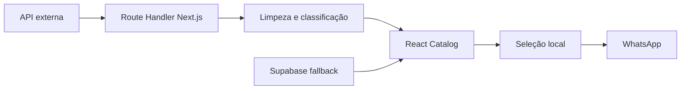

# THATA Catalog — Case técnico Full-stack

[](https://nextjs.org/)
[](https://www.typescriptlang.org/)
[](https://react.dev/)
[](https://threejs.org/)

**Catálogo responsivo com integração de dados, regras de qualidade e automação de atendimento**, desenvolvido para a THATA Body Piercing.

**Demo:** https://thata-catalogo.vercel.app  
**Portfólio:** [Thalita Monteiro Marega](https://github.com/thalitamarega)

## Contexto

O catálogo precisava apresentar uma seleção muito grande de joias sem virar um e-commerce tradicional: a cliente deveria conseguir encontrar uma peça rapidamente, montar uma seleção e iniciar uma conversa no WhatsApp. A fonte dos dados era externa e apresentava desafios reais de qualidade, disponibilidade e padronização.

## Resultado

- Busca textual, filtros combináveis, paginação e visualização de detalhes.
- Seleção de múltiplas joias e geração de mensagem estruturada para WhatsApp.
- Interface responsiva para celular e desktop.
- Importação de milhares de produtos com tolerância a falhas parciais.
- Catálogo continua utilizável mesmo quando a fonte externa está indisponível.
- Regras de priorização e auditoria de imagens para manter qualidade visual.

## Arquitetura



### Fluxo de dados

1. A API Route busca páginas de produtos em paralelo.
2. Cada registro é limpo, normalizado e classificado por tipo e material.
3. Produtos duplicados são removidos por ID.
4. A melhor imagem é escolhida com uma pontuação baseada em resolução, posição na galeria e características do produto.
5. Quando a fonte não responde, o front-end consulta o catálogo de fallback no Supabase.

## Principais decisões técnicas

| Desafio | Solução aplicada | Conhecimento demonstrado |
| --- | --- | --- |
| Fonte externa instável | `Promise.allSettled` para manter páginas válidas mesmo com falhas pontuais | Concorrência, tolerância a falhas e UX resiliente |
| Dados duplicados | `Map` indexado por ID de produto | Estruturas de dados e consistência |
| Textos com HTML e codificação quebrada | Sanitização de HTML, decodificação e normalização Unicode | Integração de APIs e qualidade de dados |
| Filtros inconsistentes | Classificação determinística a partir de título, tags e tipo | Modelagem e transformação de dados |
| Catálogo extenso | Paginação, `useMemo` e imagens otimizadas | Performance de front-end |
| Imagens de qualidade desigual | Ranking de galeria e substituições associadas por `slug` | Regras de negócio e integridade de dados |
| Atendimento manual | Carrinho de seleção e URL de WhatsApp com contexto | Integração de produto e automação de fluxo |
| Hero visual | Modelo de argola em Three.js com WebGL, luzes e animação | Renderização 3D no navegador |

## Funcionalidades implementadas

### Catálogo e experiência de uso

- Busca sem acentuação por nome da joia.
- Filtros por material e tipo de joia, com retorno automático para a primeira página.
- Paginação com scroll para o catálogo.
- Modal de detalhes e estados vazios/carregamento.
- Seleção persistente durante a navegação e remoção individual de itens.
- Mensagem de WhatsApp já formatada com nomes e códigos dos produtos.

### Back-end e dados

- Route Handler em Next.js para integração com API JSON externa.
- Cache HTTP com `s-maxage` e `stale-while-revalidate`.
- Processamento paralelo de páginas de produtos.
- Fallback em Supabase quando a atualização remota falha.
- Limpeza de descrição HTML e correção de problemas de encoding.
- Inferência de categorias e materiais a partir de metadados.

### Qualidade visual e 3D

- Seleção de imagens por pontuação de resolução e posição, com prioridade máxima para composições oficiais que mostram prata/natural e dourado juntos.
- Mapeamento manual por `slug` para evitar associar imagens de peças parecidas incorretamente.
- Script em Node.js/Sharp para triagem de marca d'água por análise de pixels.
- Hero em Three.js com geometria 3D real, materiais físicos, iluminação e descarte correto de recursos WebGL.
- Respeito a `prefers-reduced-motion` para acessibilidade.

## Stack

| Camada | Tecnologias |
| --- | --- |
| Front-end | React 19, Next.js 16, TypeScript, CSS |
| Back-end | Next.js Route Handlers, Fetch API, cache HTTP |
| Dados | API JSON externa, Supabase |
| 3D | Three.js, WebGL |
| Processamento de imagem | Node.js, Sharp |
| Deploy | Vercel |

## Estrutura

```text
app/
├── api/catalog/route.ts          # importação, limpeza e classificação
├── components/HeroPiercing3D.tsx # cena Three.js e ciclo de vida WebGL
├── globals.css                   # design responsivo
└── page.tsx                      # filtros, catálogo, seleção e WhatsApp
lib/
├── image-overrides.ts            # associação segura de imagens aprovadas
└── supabase.ts                   # cliente de fallback
scripts/
└── watermark-score.mjs           # auditoria visual de imagens
```

## Executando localmente

```bash
npm install
npm run dev
```

Para validar a versão de produção:

```bash
npm run build
npm run start
```

## O que este projeto demonstra

Este projeto foi construído como um produto real, não como exercício isolado. Ele demonstra a capacidade de:

- transformar uma necessidade de negócio em fluxo de produto;
- desenvolver interfaces responsivas com React e TypeScript;
- integrar e tratar dados externos imperfeitos;
- escrever regras de negócio e lidar com estados de falha;
- otimizar navegação e renderização de catálogos grandes;
- aplicar IA de forma prática para investigação, prototipação e controle de qualidade, com validação no código;
- iterar a partir de feedback e entregar uma versão publicada.

---

Desenvolvido por **Thalita Monteiro Marega**.
